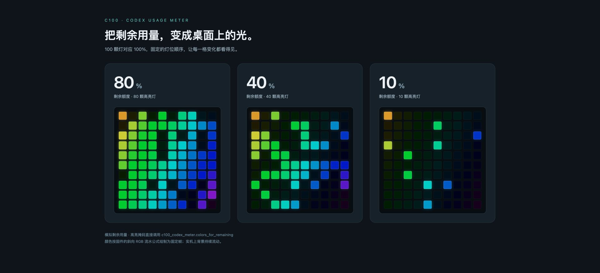

# C100 Codex 用量状态灯

把 Codex 五小时窗口的剩余用量放到桌面上。C100 的 100 颗灯对应 100%，剩余 40% 时有 40 颗高亮灯。



上图由电脑端的实际灯位算法生成，使用 80%、40%、10% 三组模拟用量。固件在全部灯位上运行斜向 RGB 流水，高亮灯表示剩余额度，低亮灯保留背景。

## 工作方式

- 电脑端每 15 秒检查本机 Codex 会话记录中的五小时限额字段。
- 剩余数值换算成 0～100 颗高亮灯，通过 USB Raw HID 发给 C100。
- 灯位按固定随机顺序分布，数值减少 1% 时只减少一颗高亮灯。
- C100 固件持续绘制流水背景，电脑端负责更新高亮掩码。

监控器读取 `rate_limits.primary` 下 `window_minutes=300` 和 `used_percent`。会话记录含这些字段时，程序据此计算；`--percent` 可直接输入模拟值检查效果。

## 先看效果

需要 Python 3.10 或更新版本。

```bash
python3 c100_codex_meter.py --percent 40 --dry-run
python3 preview.py
open preview.html
python3 -m unittest discover -s tests
```

这些预览命令只使用模拟值，生成本地页面或输出灯位计算结果。

## 编译固件

在装有 QMK 工具链的环境中准备固定版本的公开固件：

```bash
git clone https://github.com/Keychron/qmk_firmware.git
git -C qmk_firmware checkout ee7390c3bbdc1f71a1cc8d54323f3f1d97868593
git -C qmk_firmware submodule update --init --recursive
cp -R firmware/keyboards/keychron/c100 qmk_firmware/keyboards/keychron/
cd qmk_firmware
qmk compile -kb keychron/c100 -km codex_meter
```

本仓库分享源码。`keymap.c` 将 100 个按键都设为 `KC_NO`，用途是桌面灯阵。编译后通过 QMK 的 AT32 DFU 流程刷入对应设备。

## 连接 C100

macOS 电脑端使用 Homebrew 的 hidapi：

```bash
brew install hidapi
python3 c100_codex_meter.py --percent 40 --once
python3 c100_codex_meter.py
```

USB 设备参数为 `3434:042C`，Raw HID 接口为 `FF60:0061`。脚本默认读取当前用户的 `~/.codex/sessions`。启动后每 15 秒检查一次，数值变化时更新灯阵。

## 登录后自动运行

`launchd/local.c100-codex-meter.plist.example` 提供模板。将其中的 `YOUR_USERNAME` 和脚本安装路径换成本机路径，保存为 `~/Library/LaunchAgents/local.c100-codex-meter.plist`，再用 `launchctl bootstrap gui/$(id -u)` 加载该文件。

## 文件

| 文件 | 用途 |
| --- | --- |
| `c100_codex_meter.py` | 限额读取、百分比计算与 USB 通信 |
| `firmware/` | C100 板级源码与自定义灯效 |
| `preview.py` | 用模拟用量生成灯阵预览 |
| `tests/` | 百分比、灯位与限额解析检查 |
| `launchd/` | 去除个人路径的自启动模板 |

公开源码及截图已完成隐私检查。Python 检查与模拟预览结果见 [发布检查](PUBLISH_REVIEW.md)。本次发布验证范围为主机算法、模板格式和源码检查，固件构建及设备刷写留在使用者的 QMK 环境完成。许可与上游来源见 [NOTICE.md](NOTICE.md)。

## 作者

[ivy987654](https://github.com/ivy987654)，某不知名小厂的全栈开发。
